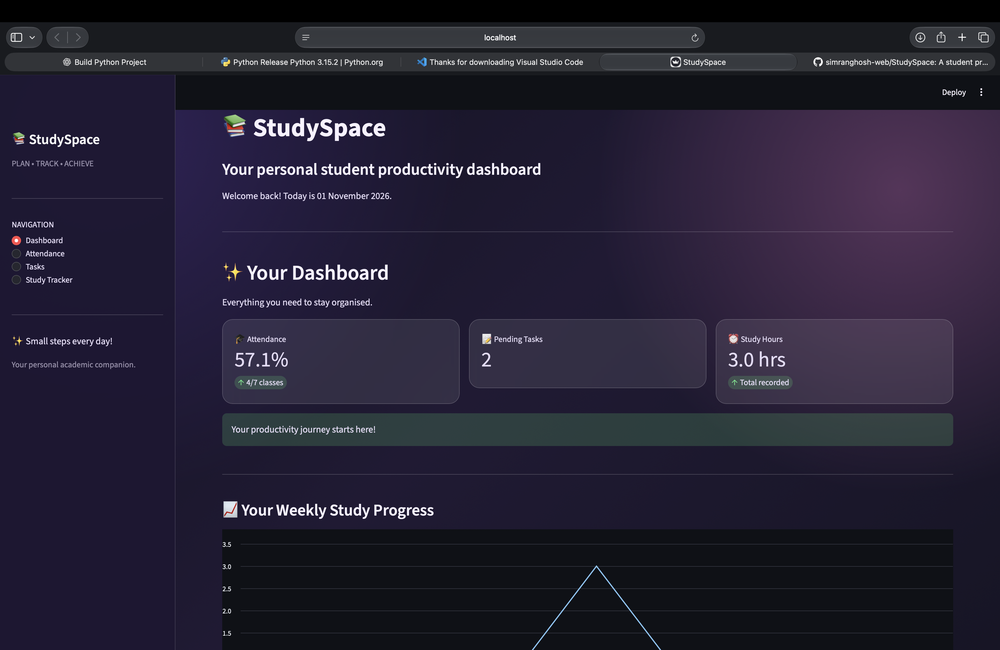

StudySpace

A Student Productivity Dashboard

StudySpace is a student productivity dashboard developed using Python and Streamlit. It provides a simple way to organize academic activities, manage assignments, track attendance, and monitor study habits.

Features

- Dashboard: Overview of academic activities and productivity.
- Attendance Tracker: Calculate attendance percentage and track progress toward a 75% attendance goal.
- Task Manager: Add, organize, and manage assignments.
- Study Hours Tracker: Record daily study hours.
- Study History: Visualize weekly study activity.
- Study Streak: Track consecutive days of studying.
- Data Persistence: Store application data locally using JSON.

Application Preview

The following screenshot shows the StudySpace dashboard.

"StudySpace Dashboard" (./screenshot.png)

Technologies Used

- Python
- Streamlit
- Pandas
- Plotly
- JSON

Installation and Setup

1. Clone the repository

git clone YOUR_GITHUB_REPOSITORY_URL
cd StudySpace

2. Install dependencies

pip install -r requirements.txt

3. Run the application

streamlit run app.py

The dashboard will open in your web browser.

Project Structure

StudySpace/
├── app.py
├── requirements.txt
├── study_data.json
├── screenshot.png
└── README.md

About the Project

StudySpace was created as a personal learning project to strengthen my Python programming skills and explore interactive application development using Streamlit.

The project focuses on building a practical productivity tool while learning about data handling, visualization, and user interface design.

---

Built with Python and Streamlit.
